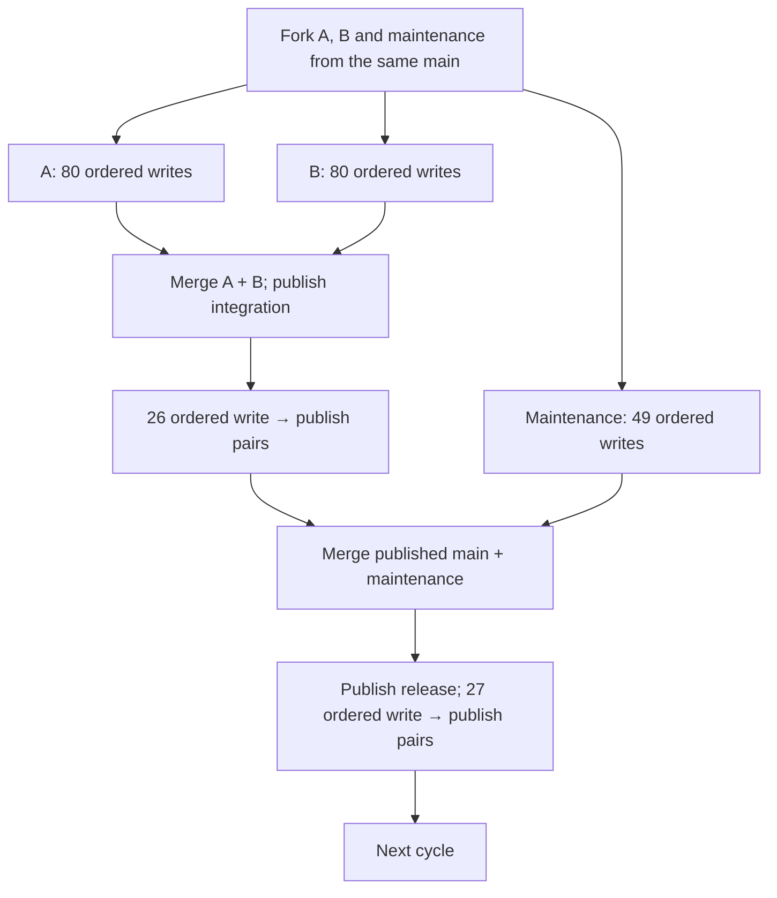

# Branch-parallel preset builds

2026-11-10. Implemented and qualified through private pilots with subagent review.
The production preset keeps all eight unequal tiers, four-machine placement,
41,640 unique commits, 857 side branches, 8,675 main Layers and 50,834 history
commands. **The full eight-tier optimized run passed**, including exact saved
history and activity capture, stable source identities and independently verified
cleanup. The [full receipt](../evidence/preset-controls/dense-eight-tier-optimized-verified-live.json)
records 247.754 seconds of history and 24.911 seconds of verification. These are
observed workflow timings with uncontrolled caches, not universal performance
guarantees or attribution to one optimization.

## Baseline and scheduling

The [original full run](../evidence/preset-controls/dense-eight-tier-live.json)
built 50,834 history commands in 673.090 seconds, followed by 92.376 seconds of
verification. Eight project scripts ran together, but each script was sequential.
The [process trace](../evidence/preset-controls/dense-eight-tier-trace-analysis.json)
shows website continuing for 284.149 seconds after the last other project.

`recipe.mjs` and `dense-recipe.mjs` now produce stable step keys, dependency keys,
branch lanes and immutable Commit receipt references. The renderer and runner use
this same plan. `history-scheduler.mjs` dispatches ready commands fairly across
projects with measured defaults **12 global / 3 per store / 3 per project**.
Dependencies never occupy a CLI slot, and finished projects release capacity to
remaining work. Each command still starts a separate real CLI process.

Each release cycle preserves these dependencies:

All three forks finish before feature writes can lead to publication. Integration
waits for A and B; maintenance may overlap integration work. Release waits for
maintenance and the final integration publication. The next cycle waits for the
final release publication. Writes on one branch and all publications to one
project's main remain ordered. This exposes independent work without changing
fork bases, ancestry or publication order. SQLite still serializes its short
physical writer transactions; branches do not create independent SQLite writers.

## Rejected same-branch pipeline

The first study inferred that the optional immutable Commit argument allowed a
publication to overlap the next write. The [first live pipeline pilot](../evidence/preset-controls/speed-native-release-dag8.json)
failed with `HeadMoved`: the requested Commit was no longer the branch head.
Cleanup was independently verified; the failed mutation was not retried.

The pinned persistence implementation,
`engine/crates/layerfs-persistence/src/history/layerstack.rs:300`, requires
`branch.head_commit == Some(request.commit)` before adding a new Layer. The
upper Store-service code and API page did not state this stricter condition.
Already-published commits have a separate `UpToDate` path. Source wins.

The corrected DAG requires **write → publish → next write** for integration and
release. Publications still name exact returned Commit IDs, but cannot overlap
head advancement. A strict test model reproduced the failure before the barrier
fix; regression tests cover every publication barrier. No LayerFS guard was
weakened, and no retry was introduced. The earlier 140-position pipeline estimate
is rejected for this runtime and must not be used to predict completion time.

## Qualified pilots and selected limits

All timings below are one-sample private diagnostics with uncontrolled caches.
Every successful arm verified saved graphs, exact content, complete CLI Activity,
actual process overlap and independent cleanup, with stable source identities.
The worker bundle stayed fixed; the release treatment optimized the macOS CLI
and matching daemon. See the [benchmark record](preset-build-benchmark.md).

| Workload / treatment | History commands | History seconds | Observed process peak |
|---|---:|---:|---:|
| Native one cycle, optimized flat | 357 | 8.395 | 1 |
| Native one cycle, corrected DAG | 357 | 5.088 | 3 |
| Native shared-store pair, corrected DAG | 714 | 6.503 | 3 |
| Eight projects, debug flat | 2,856 | 22.363 | 8 |
| Eight projects, optimized flat | 2,856 | 13.660 | 8 |
| Eight projects, optimized DAG 8 / 3 / 3 | 2,856 | 13.858 | 8 |
| Eight projects, optimized DAG 12 / 3 / 3 | 2,856 | 12.907 | 12 |
| Eight projects, optimized DAG 16 / 4 / 3 | 2,856 | 12.663 | 16 |
| Eight full unequal tiers, optimized DAG 12 / 3 / 3 | 50,834 | 247.754 | 12 |

The native one-cycle corrected DAG took 39.4% less history time than its optimized
flat arm. On the eight-project one-cycle workload, optimized flat was already
much faster than debug flat; DAG 8 did not improve its history time. DAG 12 used
5.5% less history time than optimized flat. These observations are workload
specific and are not multiplied into a projected full-tier speedup.

DAG 16 saved only 0.244 seconds (1.9%) against DAG 12 while total child-process
lifetimes rose from 114.161 to 142.381 seconds (24.7%). This is summed process
lifetime, not CPU utilization. Production therefore selects **12 / 3 / 3**,
retaining more headroom for little observed loss in throughput.

The full native lightest tier subsequently passed: 2,933 history commands,
2,400 unique commits and 500 main Layers in 38.545 seconds of history work, with
4.675 seconds of verification. This is the [nine-cycle native proof](../evidence/preset-controls/speed-native-release-dag-full-tier.json),
not an eight-project full-tier result.

## Verification and mutation custody

Verification now uses four independent store pipelines. Projects, history pages
and exact file reads remain ordered within each store. Every unique Commit,
merge parent, main Layer, publication receipt and expected file/directory check
is preserved. Progress counts confirmed projects from zero to eight. A failure
stops subsequent reads and project starts, drains dispatched reads and prevents
a capture success receipt.

The append-only step journal records an attempt before dispatch, then actual
invocation identity and the final receipt. A publication resolves its Commit
reference before recording the actual CLI argv. Unknown/interrupted effects are
not replayed. Already completed version-3 histories retain their original command
custody and can be verified without replay. Reset clears journal and activity
only through the existing verified cleanup workflow.

If writing invocation custody fails after a CLI command has been admitted, the
driver now drains that actual command before reporting the original journal
error. Successful and refused child outcomes are both consumed. This preserves
the operation lock through draining and does not retry the command.

## Activity pressure failure and correction

The [first optimized full attempt](../evidence/preset-controls/dense-eight-tier-optimized-activity-queue-diagnostic.json)
failed with `ActivityCapacity` after 2,354 history commands. The pending logger
queue reached its 8 MB limit while the archive was only about 14 MB, below the
1 GB protected archive limit. This was not a successful full build; its evidence
and independently verified cleanup remain retained.

The logger now batches disk writes and reserves bounded terminal-record capacity
before launch. When necessary, admission waits for writable room inside the CLI
slot, so queued ordinary commands cannot occupy cancellation headroom. The 8 MB
bound remains unchanged; output capture is not skipped, and actual archive or
disk failures still fail closed. Protected `workspace exec-cancel` uses reserved
control capacity.

The [post-fix pressure proof](../evidence/preset-controls/speed-studio-release-dag12-capture-pressure.json)
passed eight projects with three cycles each: 8,008 history commands, 36.821
seconds of history, 5.601 seconds of parallel verification, complete capture and
independently verified cleanup. Peak buffered plus reserved activity was
6,299,377 bytes under the unchanged 8,000,000-byte limit; terminal drops and
skipped progress were both zero. The later full proof is recorded below.

## Full eight-tier result

The [optimized full proof](../evidence/preset-controls/dense-eight-tier-optimized-verified-live.json)
passed the unchanged 50,834 history-command workload on its four final machines,
with 41,640 unique commits, 857 side branches and 8,675 main Layers. Preparation
took 21.752 seconds, history 247.754 seconds (4m 7.754s), and verification 24.911
seconds. Preparation through verification totaled 294.417 seconds (4m 54.417s),
excluding teardown. Cleanup independently found no remaining or unexpected owned
resources, and before/after source identities matched.

Against the retained original full result, history fell from 673.090 to 247.754
seconds: 63.2% less observed time, or a 2.72× ratio. Verification fell from 92.376
to 24.911 seconds. The treatment combines the optimized native runtime, corrected
branch DAG, measured admission limits, parallel verification and bounded activity
writer. These observations do not isolate each factor or establish a general
LayerFS performance claim; caches remain uncontrolled.

All 54,821 setup invocations were captured, including the 50,852 journaled
mutations (history plus preparation). Exact mutation stdin/output passed, with
zero terminal drops and skipped progress. Peak activity buffered plus reserved
bytes was 6,297,154 under the unchanged 8,000,000-byte bound, and the logger fully
drained. The [streamed process trace](../evidence/preset-controls/dense-eight-tier-optimized-trace-analysis.json)
records actual child-process overlap with no failed calls, malformed lines or
oversized lines. It does not infer overlap from task promises.

Persistent CLI sessions remain a future optimization. They would change the
one-process-per-command load model and need separate design and qualification;
none are implemented or claimed here.
